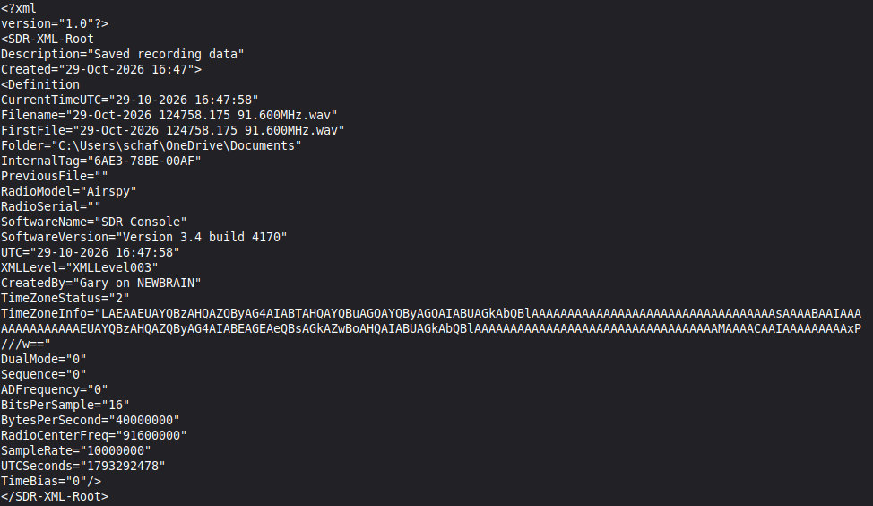

# Introduction

This program is a command line tool designed to read and display the metadata for .WAV files used in the collection of IQ data, such as is captured by SDR (software defined radios). As I'm not a real programmer, this is a VERY basic program. It can be compiled using GCC as follows:

<pre>gcc wav-reader.c -o wav-reader</pre>

Once compiled, it can be used with ./wav-reader <WAV file name>

On a Linux system, once compiled, it can be added to /usr/local/bin (typically part of the PATH) so that it can be called from any directory. 

NOTE: This program was written on and for Linux. I don't know if it will work on Windows unaltered.

# Examples

<pre>./wav-reader SDRsharp-12-28-23_91998418Hz.wav 
WAVE Reader.
********************************
Filename: SDRsharp-12-28-23_91998418Hz.wav
RIFF/RF64 file type: RF64.
The initial file size conforms to RF64 standard.
This is tagged as a WAVE file.
*********************************
Chunk type: DS64 (ds64).
Chunk size: 36 bytes
RIFF size: 6266028104 bytes.
Data size: 6266028032 bytes.
Sample count: 1566507008 samples.
Table length: 0.
********************************
Chunk type: Format (fmt ).
Chunk size: 24 bytes
The samples are in PCM format (Value = 1).
This is a standard stereo or IQ file; it has 2 channels.
The sample rate is 10000000 Sps.
Bytes / second: 40000000.
Bytes / sample: 4.
Bits / sample: 16.
********************************
Chunk type: Data (data).
Chunk size shown in DS64 section.</pre>

<pre>./wav-reader SDRuno-20261103-91.600MHz-01.wav 
WAVE Reader.
********************************
Filename: SDRuno-20261103-91.600MHz-01.wav
RIFF/RF64 file type: RF64.
The initial file size conforms to RF64 standard.
This is tagged as a WAVE file.
*********************************
Chunk type: DS64 (ds64).
Chunk size: 36 bytes
RIFF size: 2394202354 bytes.
Data size: 2394200000 bytes.
Sample count: 1197100000 samples.
Table length: 0.
********************************
Chunk type: Format (fmt ).
Chunk size: 26 bytes
This is a non-standard "format" chunk.
The values provided may not be correct.
The samples are in PCM format (Value = 1).
This is a standard stereo or IQ file; it has 2 channels.
The sample rate is 10000000 Sps.
Bytes / second: 40000000.
Bytes / sample: 4.
Bits / sample: 16.
Not all data was read in.
********************************
Chunk type: Auxiliary (auxi).
Chunk size: 1948 bytes
Chunk data size: 1940 bytes
Removing NULL characters, if any.
Found and removed NULL characters.
Found XML text. Parsing...</pre>

<pre>********************************
Chunk type: Data (data).
Chunk size shown in DS64 section.</pre>
